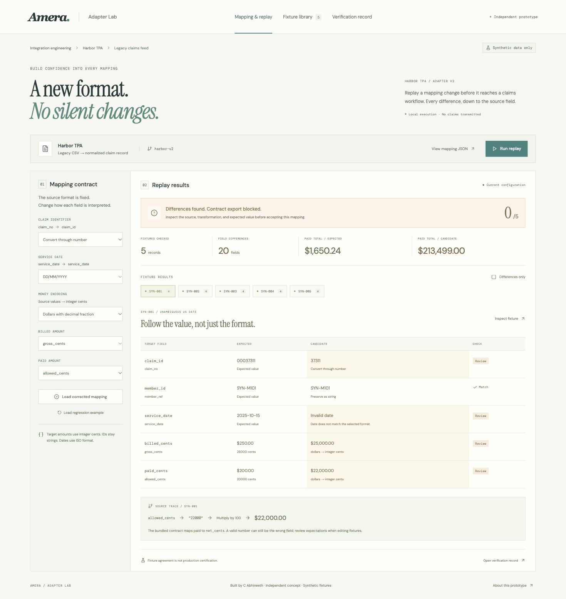

# Amera Adapter Lab

A working, independent engineering concept built by C Abhineeth for Amera's custom claims-format integration workflows.

A source field containing `25000` can mean $250.00 or $25,000.00. An allowed amount can look perfectly valid while being the wrong field for paid amount. A format mapping needs tests that preserve meaning, not just valid JSON.

Adapter Lab replays synthetic source fixtures against explicitly supplied expected outputs, shows field-level differences and source provenance, and permits mapping-contract export only when the current configuration agrees with every selected fixture.



## Run

Requires Node.js 20.19+ or 22.12+.

```sh
npm ci
npm run dev
```

Open http://127.0.0.1:5184/.

```sh
npm test
npm run build
npm run replay
```

## Try the complete workflow

1. Start with the deliberately broken mapping. Five fixtures fail with 20 field differences.
2. Inspect a fixture: a leading-zero identifier, a date interpreted with the wrong convention, cents interpreted as dollars, and allowed amount mapped into paid amount.
3. Click **Load corrected mapping**, then **Run replay**. All five fixtures pass.
4. Open **Verification record** and export the mapping contract or replay report.
5. Change a mapping setting. The previous passing result becomes stale and contract export is blocked until a fresh replay passes.
6. In **Fixture library**, edit the synthetic JSON to add or alter a source/expected-output pair. Duplicate fixture IDs, unsupported fields, invalid expected dates, non-integer expected cents, and non-synthetic member references are rejected. Fixture edits invalidate the prior result.

Configuration and fixtures persist in localStorage. A replay is recomputed from that configuration when the app loads. There is no durable run-history database.

## Headless replay

The UI and CLI use the same pure functions in `src/engine.js`.

```sh
node scripts/replay.js examples/mapping-corrected.json examples/synthetic-fixtures.json
```

This exits **0** when all expected fields match. The deliberate regression exits **1**:

```sh
node scripts/replay.js examples/mapping-regression.json examples/synthetic-fixtures.json
```

An optional fourth argument writes the complete JSON result:

```sh
node scripts/replay.js examples/mapping-corrected.json examples/synthetic-fixtures.json replay-result.json
```

Invalid configuration or fixture input exits **2**. A GitHub Actions workflow runs the tests, build, and corrected replay on pushes and pull requests.

## What is actually implemented

- String-safe claim IDs, including leading zeros.
- Strict calendar validation with explicit US, day-first, or ISO date conventions.
- Exact conversion of decimal dollar strings into integer cents, without floating-point multiplication of decimal fractions.
- Configurable billed and paid source-field selection.
- Explicit missing-value errors; absent paid values are not silently converted to zero.
- Per-field source names, raw values, applied transformations, expected values, and candidate outputs.
- Editable synthetic fixture sets with validation.
- Replay identity based on both the full configuration and fixture contents.
- A finite-fixture export gate, JSON mapping contract, Markdown replay report, and inspectable artifact previews.
- Browser-local state, responsive layouts, keyboard focus containment, and Escape dismissal.

## Why this is relevant to Amera

Research performed on October 27, 2026:

- [Amera's website](https://www.amerahealthsolutions.com/) describes multi-format normalization, integration with existing systems, claims pre-processing, stop-loss reporting, and operational visibility.
- [Amera's YC company page](https://www.ycombinator.com/companies/amera) describes a unified data layer mapping healthcare documents to hundreds of custom formats.
- [The clearinghouse page](https://www.amerahealthsolutions.com/solutions/unconventional-claims-clearinghouse) describes converting heterogeneous inputs into consistent claims workflows.
- [The pre-processing page](https://www.amerahealthsolutions.com/solutions/intelligent-claims-pre-processing) already advertises validation and routing, so this prototype does not rebuild those broad capabilities.

The proposed contribution is a narrow integration-engineering workbench for regression testing mapping changes before they enter downstream workflows. It is not a verified gap in Amera's private product, and no access to their code, customer data, schemas, or infrastructure was available. There is no guarantee of business impact or hiring response.

The design takes its direction from Amera's live site: warm off-white surfaces, editorial serif headings, generous spacing, and restrained teal accents. No proprietary product code, customer data, or marketing images were copied.

## Scope and limits

All five bundled records and the Harbor TPA name are fictional. Member references start with `SYN-`. The example target schema is authored for this prototype; it is not an Amera, X12, FHIR, HIPAA, or carrier-approved schema.

The app consumes JSON fixtures containing already parsed CSV-shaped source fields and independently supplied expected outputs. It does not parse raw CSV, EDI, PDFs, scanned documents, or receipt images. It does not use an LLM, perform medical coding, verify eligibility, adjudicate claims, calculate member liability, or submit claims to any system.

The finite synthetic fixture set is a demonstration, not exhaustive validation. Matching fixtures does not prove real-world correctness, security, regulatory compliance, financial reconciliation, throughput, or production readiness. The examples cover non-negative source amounts; adjustments, reversals, multi-line claims, and payer-specific contracts need additional models and fixtures. Values use safe JavaScript integers. Browser financial totals are illustrative fixture aggregates, not a ledger.

No application records are transmitted to a backend. Google Fonts is requested for open-source typography, with system fallbacks. Browser localStorage is not a secure production claims environment; use synthetic data only.

## Repository guide

- `src/engine.js`: normalization, fixtures, replay, validation, and export logic.
- `src/main.jsx`: interactive mapping, fixture library, and verification views.
- `scripts/replay.js`: CLI entry point.
- `tests/engine.test.js`: eleven meaningful engine tests.
- `examples/`: fixture JSON, corrected and broken configurations, verification contract, and regression report.
- `screenshots/`: three real local-browser captures.
- `VERIFICATION.md`: evidence and remaining verification limits.
- `OUTREACH.txt`: copy-ready email with literal repository and resume URLs.
